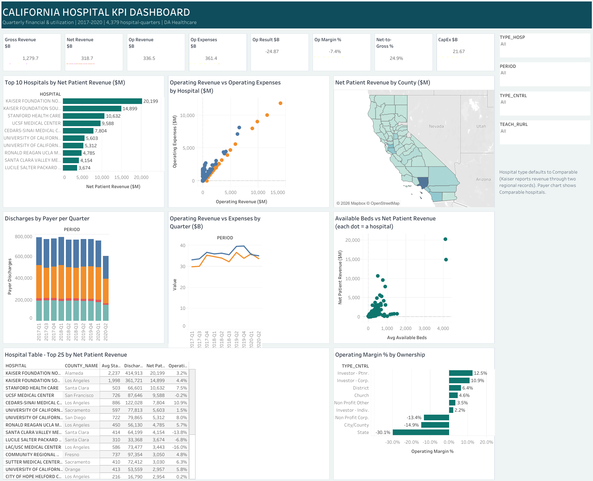

# Healthcare Analytics Dashboard – California Hospital KPIs (2017–2020)

End-to-end analysis of the financial and operational performance of **455 California hospitals** across **10 quarters (2017-Q1 to 2020-Q2)**. I built it in **Excel, MySQL, Tableau and Power BI**, and the KPIs match across all four tools.

*Tableau dashboard shown with all hospital types selected; the KPI tables below use the default "Comparable" hospital view.*

---

## Business questions
1. How much revenue do California hospitals actually collect compared with what they bill?
2. Are hospitals profitable, and which types of ownership perform best or worst?
3. Which payers (Medicare, Medi-Cal, private insurance) drive patient volume and revenue?
4. How did COVID-19 (2020-Q2) affect patient volume and margins?

## Dataset
| Item | Detail |
| --- | --- |
| Source | California quarterly Hospital Financial & Utilization reports (HCAI, formerly OSHPD) |
| Scope | 455 hospitals · 10 quarters · **4,379 hospital-quarter rows** · 117+ financial and utilization columns |
| Payer table | **17,516 rows** (one row per hospital × quarter × payer) |
| Default view | "Comparable" hospitals (381 standard acute-care hospitals). Kaiser is shown separately because it reports revenue through two regional records. |

## Tools and skills
| Tool | What I did |
| --- | --- |
| **Excel** | Cleaned and merged 10 quarterly files; built SUMIFS-driven KPI cards, an interactive dashboard with dropdown filters, PivotTables with slicers, a data dictionary and a cleaning log |
| **MySQL 8** | Designed the schema (2 tables, primary keys, indexes), loaded about 22K rows, and wrote KPI queries using aggregations, `CASE` pivots, CTEs and window functions (`LAG`, `SUM() OVER`) |
| **Tableau** | Interactive *Hospital KPI Dashboard*: 8 KPI tiles, quarterly trend, county map, top-10 hospitals, payer mix, margin by ownership, beds vs revenue scatter |
| **Power BI** | Matching dashboard with 6 KPI cards, 4 slicers, filled map, line, bar, scatter and table visuals (saved as a .pbip project) |
| **QA** | Reconciled 10 KPIs across Excel, MySQL, Tableau and Power BI. All match; the only differences are rounding. |

## Data cleaning highlights
- Combined **10 quarterly files** (CSV + XLSX) into one clean table
- Converted numbers stored as text (e.g. `"4,067,935 "`) to real numbers across **117 columns**
- Standardised inconsistent values (OPEN/Open in 1,296 rows; HSA codes in about 330 rows)
- Filled missing county and ownership values from the same hospital's other quarters
- Used the latest name for hospitals renamed during the period, matched on the facility ID
- Added calculated fields: gross revenue, operating revenue, operating result, operating margin and net-to-gross ratio

## Key KPIs (Comparable hospitals, all quarters)
| KPI | Value |
| --- | --- |
| Gross patient revenue (billed) | $1,142.8 B |
| Net patient revenue (collected) | $270.0 B |
| Total operating revenue | $283.4 B |
| Operating expenses | $273.9 B |
| Operating result | $9.5 B |
| Operating margin | 3.36% |
| Net-to-gross ratio | 23.6% |
| Capital expenditure | $18.9 B |
| Discharges | 7.43 M |

## Key insights
1. **Hospitals collect only about 24 cents per dollar billed.** The net-to-gross ratio is 23.6%, so list prices are far above what is actually collected.
2. **Margins are thin, and 37% of hospitals lost money.** The overall operating margin is 3.4%, and 140 of 381 hospitals had an operating loss over the period.
3. **Private insurance drives revenue.** Third-party payers account for **24.6% of discharges but 41.6% of net revenue**. Medicare accounts for 38.8% of discharges but only 28.2% of revenue.
4. **COVID-19 hit in 2020-Q2.** Discharges fell **19% quarter-on-quarter** (741K → 601K), and the operating margin turned negative (**−3.3%**) for the first time in the period.
5. **Ownership matters.** Investor-owned hospitals ran margins of about **11%**, while City/County (public) hospitals ran at **−12.4%**. Teaching hospitals barely broke even (0.3%).
6. **Revenue is concentrated geographically.** Los Angeles County alone generates **26.6%** of net patient revenue. Cedars-Sinai is the top hospital at $7.8 B.

## Repository contents
| File | Description |
| --- | --- |
| `Hospital_Analytics_Dashboard.xlsx` | Excel workbook: Dashboard, Pivot Analysis, KPI Calculations, SQL Results, QA Reconciliation, Cleaned Data, Data Dictionary, Cleaning Log |
| `DA_Healthcare_SQL.zip` | MySQL scripts: `01_create_schema.sql`, `02`–`03` data loads, `04_kpi_queries.sql` |
| `DA_Healthcare_Dashboard.twbx` | Tableau packaged workbook (open in Tableau Public or Desktop) |
| `PowerBI_Project.zip` | Power BI project (.pbip) for the Hospital KPI Dashboard |
| `Presentation/DA_Healthcare_Final_Presentation.pptx` | Final project presentation |
| `Presentation/DA_Healthcare_PowerBI_Dashboard.pptx` | Power BI dashboard walkthrough |
| `Documentation/DA_Healthcare_Process_Document.docx` | Step-by-step process of how the project was built |
| `Documentation/DA_Healthcare_Excel_Cleaning_Guide.docx` | Data cleaning steps in Excel |
| `Screenshots/Hospital_KPI_Dashboard.png` | Tableau dashboard screenshot |

## How to run the SQL
1. Unzip `DA_Healthcare_SQL.zip`
2. Run the scripts in MySQL Workbench in order: `01` → `02` → `03` → `04`
3. Run the queries in `04_kpi_queries.sql` one at a time to reproduce every KPI

---
**Author:** Shravan Kumar Gowlikar · Hyderabad, India
